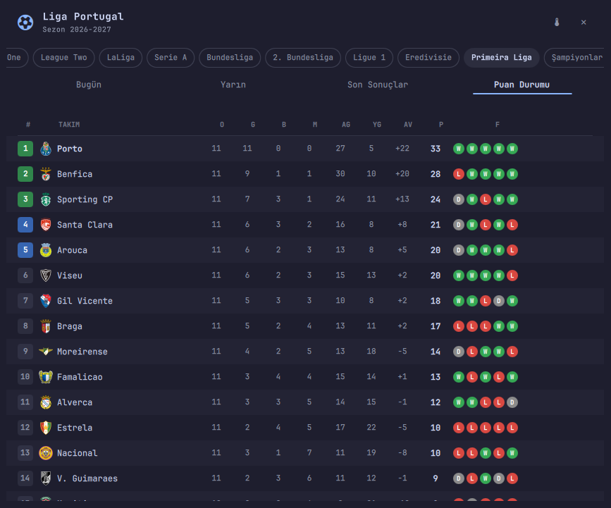

# Futbol — Omarchy plugin

Maçkolik-style football for the Omarchy bar and popup panel. Scores, fixtures and full league tables with team crests, live minute:second on match days, match details (goals, cards, subs, starting XIs, officials).



## Features

- **Leagues (18):** Trendyol Süper Lig, TFF 1./2./3. Lig, Premier League, Championship, League One/Two, LaLiga, Serie A, Bundesliga, 2. Bundesliga, Ligue 1, Eredivisie, Liga Portugal, UEFA Champions/Europa/Conference League
- **Bugün / Yarın / Sonuçlar / Puan Durumu** tabs
- **Match details on tap**: big score, live minute:second counter (İY included), referee line, event timeline (goals with assists and running score, yellow/red cards, substitutions, home left / away right), starting XIs with formation
- **Standings**: rank, crest, O/G/B/M/AG/YG/AV/P, form pills (last 5), champion/Europe/relegation zone colours, season label and update date
- Keyboard: `R` refresh · `1–4` tabs · `j/k` scroll · `Tab` next panel · `B`/`Esc` back
- English and Turkish UI

## Install

```sh
omarchy plugin add https://github.com/Denizwsa/omarchy-superlig.git
```

Uninstall:

```sh
omarchy plugin remove superlig.futbol
```

## Dependencies

- Omarchy shell (Quickshell) — plugin runtime, no extra packages to install
- `curl` — shipped with Omarchy
- `python3` standard library only — no pip, nothing to install

## Data source

Data comes from public pages and endpoints on **mackolik.com** (this plugin is unofficial and not affiliated with mackolik). League tables and full-season fixtures come from the league page (`/r/lig/<id>`), live state from the daily livescores JSON. Requests happen **only when the panel is opened and while it stays open** (auto-refresh every N minutes, default 10) — roughly 1–4 requests per refresh, ~4–5 MB per league load. No traffic runs in the background when the panel is closed. A polite UA is sent and failed requests retry with backoff; last good data stays on screen.

Team crests: `https://file.mackolikfeeds.com/teams/<id>`.

## Limits

- No substitutions bench (match page embeds starting XIs only), no manager/stadium
- Live minute is computed from the feed's period-start timestamps
- Fixture times are shown exactly as mackolik displays them
- If mackolik rate-limits (502/503), the panel keeps showing the last good data

## License

MIT — see [LICENSE](LICENSE).
